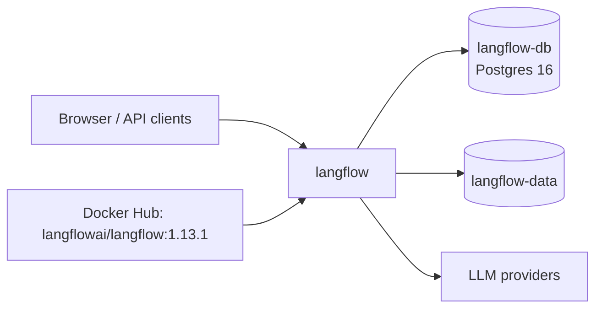

<div align="center">

# Langflow on Render

Build AI agents and workflows with a visual editor, then serve them as APIs or MCP servers. This repo is the Blueprint. The app runs from the official [Langflow](https://github.com/langflow-ai/langflow) image.

<p>
  <a href="https://render.com/deploy-template/api/github/start?template_repo=langflow">
    
  </a>
</p>

<p>
  <a href="https://render.com">
    
  </a>
  <a href="https://github.com/langflow-ai/langflow">
    
  </a>
  <a href="https://github.com/langflow-ai/langflow/blob/main/LICENSE">
    
  </a>
</p>

</div>

## What This Template Shows

This repository does not contain the Langflow source. The service pulls the official image from Docker Hub at a pinned version. To upgrade, change the tag in [`render.yaml`](./render.yaml) and push.

| Piece | Role |
| --- | --- |
| **[Langflow](https://github.com/langflow-ai/langflow)** | Visual editor, flow runtime, API, and MCP server in one container. |
| **`langflow`** ([Web Service](https://render.com/docs/web-services)) | The app. |
| **`langflow-db`** ([Render Postgres](https://render.com/docs/postgresql)) | Users, flows, messages, and global variables. |
| **`langflow-data`** ([Persistent disk](https://render.com/docs/disks)) | Langflow's config folder and uploaded files. |

## Architecture



### How It Works

1. Click **Deploy to Render**. The flow copies this repo into your GitHub account and applies [`render.yaml`](./render.yaml).
2. Render creates the database and disk, and generates `LANGFLOW_SECRET_KEY` and `LANGFLOW_SUPERUSER_PASSWORD`. There is nothing to fill in.
3. On first boot, Langflow runs its database migrations and creates the `admin` account.
4. Sign in, add your model provider keys, and build flows.

| Resource | Type | Plan | Notes |
| --- | --- | --- | --- |
| `langflow` | Web, image | Standard | Disk at `/app/data`, 5 GB. Health: `/health_check`. Single instance. |
| `langflow-db` | Postgres 16 | Basic 256 MB | No external access (`ipAllowList: []`). |

Default region: **Oregon**.

### Render-specific settings

Langflow's defaults suit a laptop. This template changes them for a public URL.

| Setting | Why |
| --- | --- |
| `LANGFLOW_AUTO_LOGIN=false` | The default signs every visitor in as an admin. |
| `LANGFLOW_SUPERUSER` and `LANGFLOW_SUPERUSER_PASSWORD` | Creates the `admin` account with a generated password. |
| `LANGFLOW_NEW_USER_IS_ACTIVE=false` | Accounts you create stay inactive until an admin activates them. |
| `LANGFLOW_CUSTOM_COMPONENT_ADMIN_ONLY=true` | Custom components run arbitrary Python on the server. Only admins can create or edit them. |
| `LANGFLOW_CORS_ORIGINS` | The service's public URL, instead of `*`. |
| `LANGFLOW_SECRET_KEY` | Encrypts stored API keys and global variables. Generated once, so it stays the same across deploys. |
| `DO_NOT_TRACK=true` | Turns off Langflow's telemetry. |

With these settings, Langflow starts without its security and CORS warnings.

## Quick Start

1. Click **Deploy to Render** above.
2. Wait until `langflow` is **Live**. The first boot takes about two minutes.
3. Copy `LANGFLOW_SUPERUSER_PASSWORD` from the service's **Environment** page.
4. Open the service URL and sign in as `admin`.
5. Add a model provider key under **Settings → Global Variables**, then create a flow from a starter template.

```bash
curl -fsS "https://<langflow>.onrender.com/health_check"
```

## Configuration

| Variable | Source | Description |
| --- | --- | --- |
| `LANGFLOW_DATABASE_URL` | Wired | Internal connection string for `langflow-db`. |
| `LANGFLOW_SECRET_KEY` | Generated | Encrypts stored secrets. Back it up. If it changes, Langflow can't decrypt saved API keys and global variables. |
| `LANGFLOW_SUPERUSER_PASSWORD` | Generated | Password for `admin`. Change it in the UI afterward. |
| `LANGFLOW_CORS_ORIGINS` | Wired | The service's `RENDER_EXTERNAL_URL`. Add your custom domain after you set one up. |
| `LANGFLOW_CONFIG_DIR` | Blueprint | `/app/data/.langflow`, on the disk. |
| `LANGFLOW_HOST`, `LANGFLOW_PORT` | Blueprint | `0.0.0.0` and `7860`. |
| Others | Optional | Model provider keys, worker count, logging. See [`.env.example`](./.env.example). |

`generateValue` runs once, on the first Blueprint apply.

## Cost

Prices from [Render's pricing page](https://render.com/pricing).

| Resource | Approx. monthly |
| --- | ---: |
| `langflow` (Standard) | $25 |
| 5 GB disk | $1.25 |
| `langflow-db` (Basic 256 MB) | $6 |
| **Total** | **~$32.25** |

Langflow used about 830 MB of memory after startup in testing, so the Starter plan (512 MB) is too small. Model calls go to your providers and are billed by them.

## Troubleshooting

| Problem | Solution |
| --- | --- |
| First deploy fails with a database connection error | The database wasn't ready yet. Select **Manual Deploy** on `langflow`. |
| Deploy fails with out of memory | Use the Standard plan or larger. |
| Saved API keys fail to decrypt after a change | `LANGFLOW_SECRET_KEY` changed. Restore the original value. |
| The UI shows CORS errors on a custom domain | Set `LANGFLOW_CORS_ORIGINS` to the domain in your browser. |
| Deploy takes about a minute of downtime | Expected. A service with a disk stops the old instance before it starts the new one. |
| Log says `Skipping starter project ... unavailable components` | Upstream warning. The other starter projects work. |

## Project Structure

```
render.yaml       Blueprint. Image-backed web service with a disk, plus Postgres.
README.md         This file
LICENSE           Wrapper license
.env.example      Optional settings
```

## Learn More

- [Blueprint spec](https://render.com/docs/blueprint-spec)
- [Langflow docs](https://docs.langflow.org)
- [Langflow environment variables](https://docs.langflow.org/environment-variables)
- [Langflow on GitHub](https://github.com/langflow-ai/langflow)

## License

[MIT](LICENSE) for this wrapper. Langflow is licensed under [MIT](https://github.com/langflow-ai/langflow/blob/main/LICENSE).
